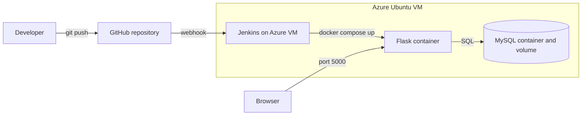

Two-Tier Flask App: CI/CD with Docker and Jenkins on Azure
A Flask + MySQL "Notes Board" that is built, tested and deployed automatically.
Every push to main triggers a Jenkins pipeline on an Azure VM.

Architecture


Tech stack
Python 3.12, Flask, gunicorn, PyMySQL
MySQL 8.4
Docker and Docker Compose
Jenkins (declarative pipeline)
Microsoft Azure (virtual machine, network security group)
Pipeline stages
Checkout
Build image
Unit tests
Deploy with Docker Compose
Health check
Screenshots


Run it yourself
```bash
git clone https://github.com/<your-username>/two-tier-flask-azure-jenkins.git
cd two-tier-flask-azure-jenkins
cp .env.example .env # then set DB_PASSWORD in .env
docker compose up -d --build
```

Open http://localhost:5000

Design decisions
The database port is not published, so only the web container can reach MySQL.
Notes live in a Docker volume and survive restarts and redeploys.
The database password is stored in Jenkins credentials, never in Git.
Docker health checks and a pipeline health stage confirm both tiers are working.
The web container runs as a non-root user.
What I learned
<write 3 or 4 points in your own words>
